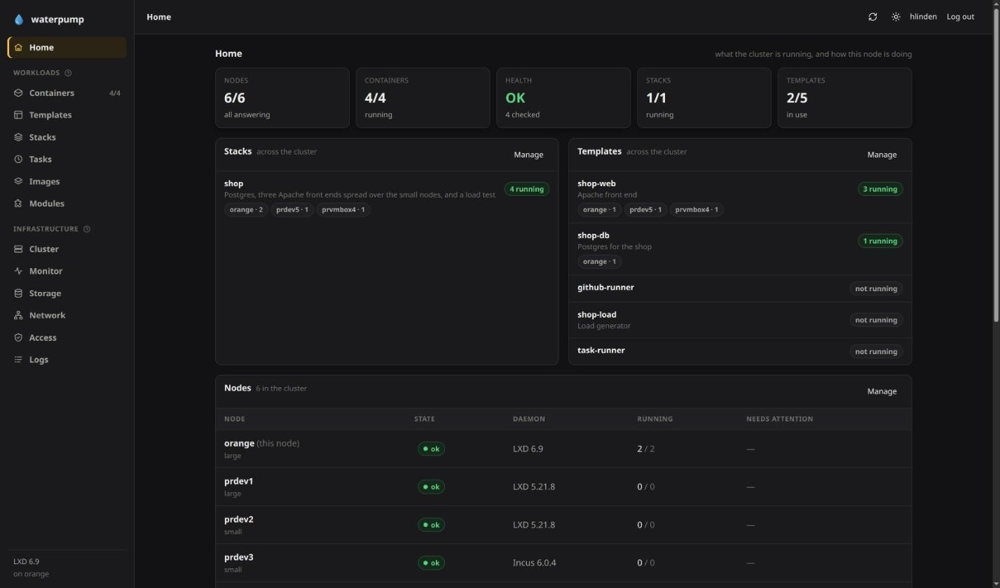
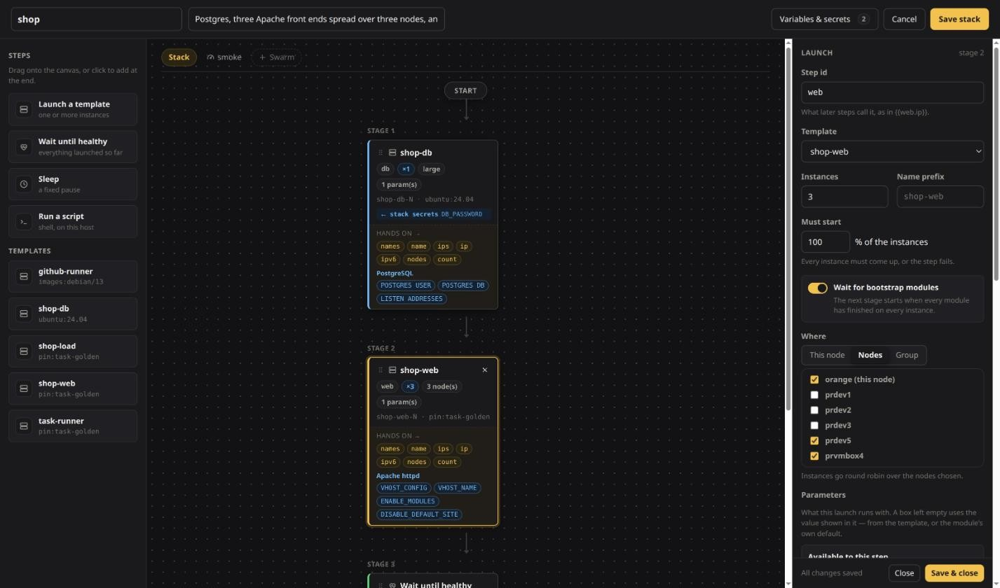
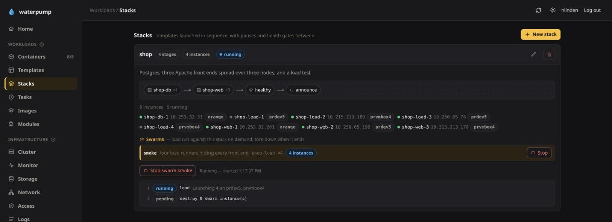
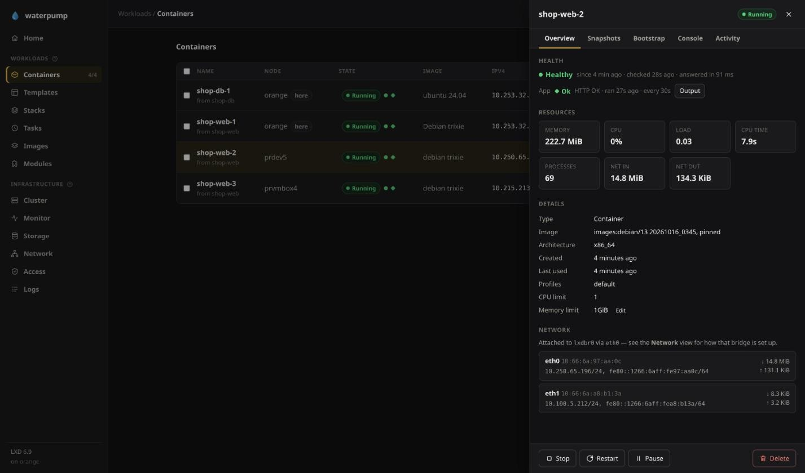
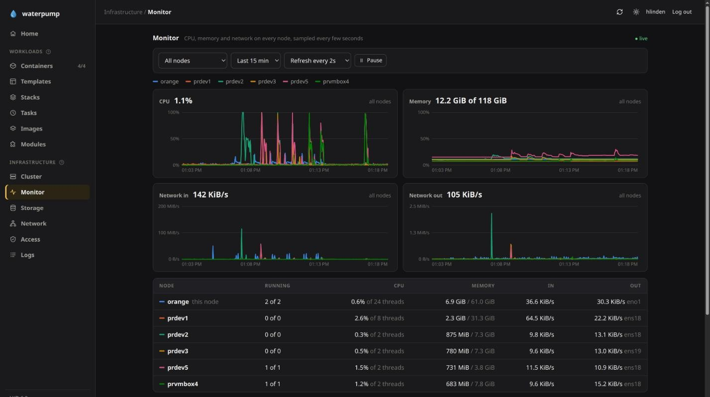
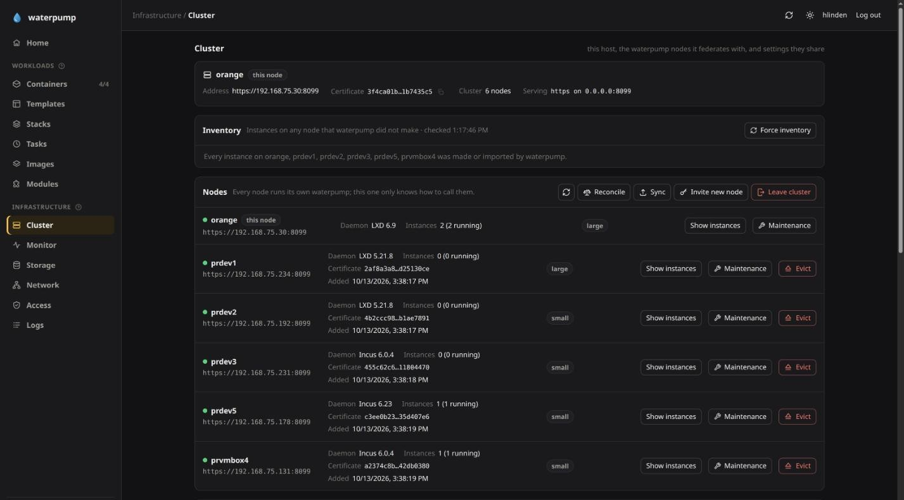

# waterpump

**Deploy whole applications on LXD and Incus, across every host you have, from
one definition.**

You describe a deployment once, as a **stack**. A stack might be a database,
then three web servers that are given its address, then a health gate, then a
script that announces it is live. waterpump launches it in order across your
nodes, wires the tiers together and waits until they are healthy. From then on
you run the deployment as one thing: stop it, start it, relaunch it, load-test
it, watch it live, and see when it has drifted from its definition.



```
  stack "shop"                     node-a          node-b          node-c
  ──────────────────────────────   ─────────────   ─────────────   ─────────────
  1  db    Postgres x1        ──▶  shop-db-1
  2  web   Apache x3          ──▶  shop-web-1      shop-web-2      shop-web-3
       DB_HOST={{db.ip}}           └──────────── fabric 10.100.0.0/16 ─────────┘
  3  wait until healthy
  4  swarm "smoke"            ──▶  … load runners, torn down when they finish …
```

## Why waterpump

- **Plain system containers and VMs, orchestrated.** You get the speed and
  density of LXD/Incus with the "describe it, launch it, operate it" workflow
  of a container orchestrator. Your workloads don't have to be rebuilt as OCI
  images first.
- **A cluster with no control plane.** Each node is a complete waterpump.
  Nodes join with one code, there is no leader and no quorum, and losing a
  host costs you that host only. Templates, stacks and modules sync to every
  node as you save them.
- **A network that spans hosts.** A *fabric* gives every node a routed subnet
  of one prefix, so `{{db.ip}}` works from any host. You can also put
  instances straight onto your LAN.
- **Health you can gate on.** Every instance gets machine checks (responsive,
  load, near limits) plus your own Nagios-style app check. A stack waits for
  them, and the UI and `waterpump top` show them live.
- **One API, three front ends.** The web UI, the CLI and the REST API are the
  same thing: `--json` on any command prints exactly what the API returns.
- **Nothing to install.** The backend is stdlib-only Python 3.10+, with no pip,
  virtualenv or database. The release archive ships with the UI already built.

<table>
<tr>
<td width="50%"><a href="docs/screenshots/stack-designer.jpg"></a><br><b>Design a stack</b> by dragging steps onto a canvas. Each step shows exactly what it hands on to later ones.</td>
<td width="50%"><a href="docs/screenshots/stack-run.jpg"></a><br><b>Operate it as one thing.</b> Here a load-test swarm runs against the live stack and is torn down when it ends.</td>
</tr>
<tr>
<td><a href="docs/screenshots/instance.jpg"></a><br><b>Every instance, any node:</b> health, app check, resources, snapshots, bootstrap and a live console.</td>
<td><a href="docs/screenshots/monitor.jpg"></a><br><b>Watch the cluster</b>: CPU, memory and network for every node and instance, live.</td>
</tr>
</table>

## How it fits together

Each building block is made from the one before it:

| | What it is | Read more |
| --- | --- | --- |
| **Module** | A POSIX shell script that configures an instance (packages, users, services), with parameters and never-stored secrets. | [modules](docs/modules.md) |
| **Template** | A whole instance: image, container or VM, limits, network, modules and an app health check. | [templates](docs/templates.md) |
| **Stack** | Templates launched in stages, each one handed the names and addresses of the earlier ones, with health gates, scripts and load-test swarms. **This is the unit you deploy.** | [stacks](docs/stacks.md) |
| **Task** | A job run in a throwaway instance, on a cron schedule, on demand or from a GitHub webhook. The cluster votes so that each occurrence runs at most once. | [tasks](docs/tasks.md) |
| **Nodes** | Hosts joined with one code, each with its own daemon. Steps land on named nodes or on node groups. | [nodes](docs/cluster.md) |
| **Fabric** | A routed network across every node, so tiers reach each other whichever host they are on. | [networking](docs/networking.md) |



## Getting started

**1. Check the prerequisites.** You need **LXD or Incus** with its daemon
running (`snap install lxd`, or `apt install incus` on Debian 13+), and
**Python 3.10+**. Your user must be in the daemon's admin group, `lxd` or
`incus-admin`. Check with `id`; after `sudo usermod -aG lxd $USER`, log out
and back in.

**2. Download and start it.** The release archive already contains the built
UI:

```bash
curl -LO <repo>/releases/latest/download/waterpump-<version>.tar.gz
tar xzf waterpump-<version>.tar.gz && cd waterpump-<version>
./waterpump serve --open          # opens http://127.0.0.1:8099
```

The first start is *unconfigured mode*: it listens on `127.0.0.1` only, has no
login and serves plain HTTP. Nothing off this host can reach it, so it is safe
to look around. If the daemon has never been set up, press **Initialize** (or
run `./waterpump init`) to create a storage pool, a bridge and a default
profile.

**3. Turn on logins and HTTPS.** Press **Configure node** in the banner. Choose
an admin username and password, a certificate (generate a self-signed one, or
upload your own) and whether to listen on every interface. waterpump saves
everything and restarts itself, then the browser continues at `https://` and
asks for the new login. With a self-signed certificate, the browser warns once.
Compare the fingerprint the dialog shows before accepting it. From a shell, run
`./waterpump configure node` and then restart `serve`.

**4. Add people and tokens.** Accounts have a role: `read`, `operator` (run
and stop what exists) or `admin`. Add them in the **Access** tab, or:

```bash
./waterpump user-add alice --role operator   # asks for a password
./waterpump token-create ci --role read --expires 30d   # for scripts; shown once
```

To log in with host accounts (PAM) or through a reverse proxy instead, run
`./waterpump configure auth`. See [Security](docs/security.md).

**5. Keep it running.** Run `./systemd/install-service.sh` to install
waterpump as a systemd user service. It runs as you and uses the settings you
just saved. See [Running as a service](docs/service.md).

**6. Launch something.** Press **+ New** for a single container, or save a
template and launch several:

```bash
./waterpump template-save web -i images:debian/13 -c 1 -m 1GiB -b base -b apache2
./waterpump launch web -n 2
```

From there, put templates together into a [stack](docs/stacks.md).

Building from a clone instead? Run `./build.sh` once to build the UI. It is the
only step that needs Node. See [Development](docs/development.md).

### Then add more hosts

waterpump works on one host, but it is built for several:

1. Set up each host as in steps 1–5, listening on every interface.
2. `waterpump cluster invite` on one, then `waterpump cluster join CODE` on the others.
3. `waterpump cluster group auto` sorts nodes into `large` and `small`.
4. `waterpump fabric create` gives them a shared routed network.
5. Write templates and a stack, and launch it from any node.

## CLI

```
waterpump stacks | stack-show NAME | stack-save NAME FILE
waterpump stack-launch NAME          # --dry-run previews, --relaunch replaces
waterpump stack-swarm NAME SWARM...  # load tests against the running stack
waterpump stack-stop|stack-start|stack-restart|stack-destroy NAME

waterpump template-save NAME -i images:debian/13 -c 2 -b base
waterpump launch NAME -n 3 --group large   # a template on its own, over nodes
waterpump templates | modules | profiles | tasks

waterpump cluster invite | join CODE | status | containers | group auto
waterpump cluster maintenance on     # keep new instances off this node
waterpump fabric create              # a routed network across every node
waterpump image-pin IMAGE            # one build, copied to every node, as pin:NAME

waterpump top                        # live view of nodes, instances and stacks, with a console
waterpump health | status | logs -f  # health, readiness, a live tail of who did what
waterpump ls | create | exec | shell | snapshot | bootstrap   # single instances
waterpump serve                      # web UI + API
```

Every command takes `--json` and prints exactly what the REST API returns:

```bash
waterpump cluster containers --json | jq -r '.instances[] | select(.stack=="shop") | .name'
```

`waterpump --help` lists everything, and `waterpump COMMAND --help` explains one.

## Documentation

| Doc | Covers |
| --- | --- |
| [Stacks](docs/stacks.md) | stages, handing values along, health gates, secrets, scripts, swarms and reports |
| [Tasks](docs/tasks.md) | scheduled, invoked and webhook jobs; inputs; the vote on who runs each one |
| [Instance templates](docs/templates.md) | a full instance setup; app health checks |
| [Bootstrap modules](docs/modules.md) | writing modules, parameters, secrets, profiles, the shipped modules |
| [Nodes and federation](docs/cluster.md) | joining, groups, maintenance, sync and reconciliation, `waterpump top` |
| [Networking between nodes](docs/networking.md) | fabrics: routed networks shared by every node |
| [Containers on your LAN](docs/lan.md) | addresses from your router: a bridge, macvlan, or the host's NIC |
| [Web UI tour](docs/web-ui.md) | Home, health, bulk actions, Storage, Network and Access |
| [Security](docs/security.md) | logins (local, PAM, proxy), roles, API tokens, TLS |
| [Running as a service](docs/service.md) | systemd units, user vs system install |
| [Logging](docs/logging.md) | who did what, the live tail, local and remote syslog |
| [REST API](docs/api.md) | every endpoint, with request and response shapes |
| [Daemons, images and storage](docs/daemons-and-storage.md) | LXD vs Incus, image remotes and pins, quotas, units |
| [Development](docs/development.md) | source layout, the Vite dev server, how releases are cut |

## Good to know

- **Not a host manager.** The host features (init, storage, bridges,
  maintenance) exist to get a node ready. Provisioning and patching hosts
  belong to other tools.
- **Not LXD/Incus clustering.** Each node talks to its own daemon, clustered
  or not, and a cluster may mix LXD and Incus.
- **Not a scheduler.** A step's instances go round robin over the nodes it
  names. Nothing is moved when a host fails, and an instance belongs to the
  node that made it.
- **Members trust each other.** Nodes share one credential, so every node is an
  admin of every other. Only federate hosts you administer. See
  [Security](docs/security.md).
- Launches and stack runs happen on the server. Closing the browser doesn't
  stop them; stopping `serve` does.
